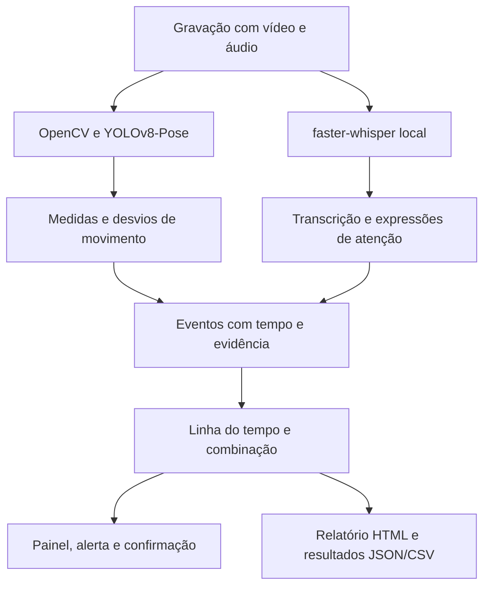

# Planejamento — Tech Challenge Fase 4

Revisado em 14/11/2026 conforme orientação do usuário: execução local e duas frentes, vídeo e áudio/transcrição. Prazo: 17/11/2026, às 23h59, horário de Brasília. Equipe de três pessoas.

Esta revisão substitui a proposta anterior e registra o planejamento inicial. Os registros ao final documentam o avanço posterior. Para o estado atual de cada etapa e suas pendências, consulte o [checklist principal](../../TAREFAS.md).

## 1. Escopo atualizado

Construir um protótipo local que analise um exercício de reabilitação, transcreva a fala, localize expressões de atenção e reúna as evidências em um relatório e painel de alertas.

As duas modalidades de entrada são vídeo e áudio. O texto transcrito é uma saída da análise do áudio, sem exigir uma terceira fonte de dados.

| Decisão | Escopo atual |
| --- | --- |
| Execução | Computador local, com modelos baixados previamente. |
| Vídeo | Um exercício, estimativa de pose, medidas e indicação de desvios. |
| Áudio | Transcrição em português, tempos dos segmentos e regras de termos de atenção. |
| Integração | Linha do tempo com evidências das duas modalidades e alerta explicado. |
| Entregáveis | Código no Git, relatório técnico e vídeo de até 15 minutos no YouTube ou Vimeo. |

A orientação do usuário sobre execução local e duas frentes é a referência desta revisão. O [PDF original](../../context/IADT%20-%20Fase%204%20-%20Tech%20challenge.pdf) continua sendo a fonte dos entregáveis; sua redação não foi alterada. O relatório deve descrever o recorte adotado.

Sinais vitais, prescrições e uma frente independente de anomalias saem da implementação prevista. A identificação de desvios permanece dentro da análise de vídeo. Sentimentos e características acústicas ficam como possíveis evoluções.

## 2. Tecnologias

| Componente | Escolha proposta |
| --- | --- |
| Ambiente | Python 3.11 e ambiente virtual, com dependências fixadas após validação. |
| Vídeo | OpenCV + Ultralytics YOLOv8n-Pose pré-treinado. |
| Movimento | NumPy e regras calibradas de ângulo, amplitude e duração para um exercício. |
| Transcrição | faster-whisper com modelo Whisper multilíngue, local. |
| Expressões de atenção | Vocabulário configurável e regras de contexto e negação. |
| Interface | Streamlit local. |
| Resultados | JSON e CSV para dados; HTML para relatório legível. |
| Avaliação | Scripts Python e jiwer para taxa de erro de palavras. |

A documentação de [YOLOv8](https://docs.ultralytics.com/models/yolov8/) oferece a variante de pose `yolov8n-pose.pt`. Estimar articulações não determina automaticamente se um exercício está correto; a decisão sobre desvios será implementada e avaliada pelo projeto.

O [faster-whisper](https://github.com/SYSTRAN/faster-whisper) executa modelos Whisper via CTranslate2 e suporta CPU com quantização de oito bits. Começar com o modelo `base`, multilíngue, `device="cpu"`, `compute_type="int8"` e idioma português. Se a qualidade for insuficiente, avaliar `small` no conjunto de calibração e medir seu custo antes de decidir. Usar variantes multilíngues, sem o sufixo `.en`.

A preparação exige internet para obter dependências, pesos e dados. Com esses arquivos disponíveis, testar a execução sem internet. A velocidade no computador ainda não foi medida; CPU é a configuração inicial proposta.

Na inspeção inicial, o comando `python` no PATH apontava para o alias da Windows Store e não executou o interpretador. O primeiro passo técnico é localizar uma instalação válida ou preparar o ambiente Python.

## 3. Fluxo da aplicação



Preferir uma gravação própria de exercício com fala no mesmo arquivo para a demonstração conjunta. Isso fornece as duas modalidades da mesma pessoa e com o mesmo relógio, em uma sessão encenada. O áudio pode ser lido do arquivo por meio da biblioteca de decodificação usada na transcrição.

Os módulos também devem aceitar vídeo e áudio separados. Registrar origem e sincronização; entradas independentes não representam uma sessão real da mesma pessoa.

O fluxo inicial processa arquivos gravados. Os instantes dos eventos se referem ao conteúdo do arquivo, enquanto a duração do processamento é medida separadamente. Só descrever funcionamento em tempo real se a implementação e as medições o demonstrarem.

## 4. Dados e avaliação

### Vídeo

Manter o [REHAB24-6](https://zenodo.org/records/13305826), que disponibiliza vídeos RGB e rótulos de correção e segmentação de exercícios. O pacote de vídeos tem aproximadamente 2,7 GB; os termos indicados são para pesquisa acadêmica ou não comercial, com citação.

Começar por um exercício e uma vista de câmera. Confirmar que dois trechos, um correto e um incorreto, podem ser abertos, processados e associados aos rótulos. Escolher o exercício e suas medidas após essa inspeção.

Separar participantes entre calibração e teste, mantendo todas as repetições e vistas da mesma pessoa na mesma partição. O teste deve conter as duas classes e não será usado para escolher limiares. Processar os vídeos com nosso estimador; coordenadas prontas da base não substituem essa etapa.

Produzir medidas normalizadas pelo corpo e coerentes com o exercício. Articulações com baixa confiança ou pessoa fora de quadro devem produzir indicação de qualidade insuficiente. Comparar a decisão por repetição com os rótulos e mostrar erros, além de acertos.

### Áudio

Preparar aproximadamente 8 a 12 gravações curtas em português, com concordância dos participantes para uso no trabalho. Incluir relatos sem queixa, expressões de atenção, negação, contexto passado, silêncio e algum ruído leve.

Criar transcrições manuais e anotar as expressões esperadas. Reservar roteiros para teste antes de ajustar regras; separar falantes quando houver amostras suficientes. Documentar a normalização de pontuação e maiúsculas usada na avaliação.

Exemplos de avaliação: relato afirmativo de dor, negação de dor e relato de dor passada já resolvida. A cobertura das regras será limitada aos padrões documentados, mantendo a frase original visível.

### Sessões conjuntas

Gravar de dois a quatro clipes de exercício com fala para demonstrar o fluxo completo. Identificá-los como simulação. A avaliação agregada do vídeo usa os dados públicos reservados; a transcrição é avaliada contra as referências manuais.

As fontes sugeridas no PDF não fixam uma base específica para este recorte. Com a retirada dos sinais vitais, o PhysioNet deixa de ser uma dependência.

## 5. Eventos, relatório e alerta

Cada execução registra identificador, fontes, versões dos modelos, parâmetros, tempo de processamento, transcrição, medidas e eventos. Um evento de vídeo contém intervalo, medida, referência e qualidade da pose; um evento de fala contém segmento, tempo e regra acionada.

Combinar eventos próximos da mesma sessão em uma janela configurável e preservar alertas de apenas uma fonte. Exemplo de saída: “desvio de movimento e relato de desconforto próximos no tempo”, com ambas as evidências. A proximidade não comprova causa entre os eventos.

O painel deve mostrar o vídeo anotado, a transcrição, a linha do tempo e o alerta, permitir exportar HTML/JSON e registrar a confirmação de recebimento. Ausência de áudio ou de pose visível deve aparecer como limitação da entrada. Os resultados serão apresentados como evidências do protótipo, sem diagnóstico médico.

## 6. Como comprovar os resultados

| Frente | Referência | Evidência |
| --- | --- | --- |
| Vídeo | Rótulos reservados da base | Precisão, recall, F1, matriz de confusão por repetição e quadros de acertos e erros. |
| Transcrição | Texto manual de áudios de teste | WER por arquivo e agregada, isto é, taxa de erro de palavras; exemplos de erros. |
| Expressões de atenção | Anotações dos roteiros reservados | Precisão/recall e casos de negação/contexto. |
| Integração | Sessões simuladas documentadas | Linha do tempo, relatório exportado e confirmação do alerta. |
| Execução local | Ambiente e modelos registrados | Tempo de processamento e ensaio com pesos já baixados. |

Ainda não há números medidos. Definir partições e parâmetros antes da avaliação final. Informar quantidade de amostras, limitações e equipamento utilizado; a escolha inicial de modelos pequenos precisa ser validada.

## 7. Entregáveis e preparação dos colegas

Propor um relatório técnico de aproximadamente 6 a 10 páginas, extensão editorial para este recorte, com fonte Markdown e versão PDF:

1. Problema e escopo: execução local, vídeo e áudio.
2. Dados, termos de uso, simulações e partições de avaliação.
3. Arquitetura e fluxo das duas modalidades.
4. Métodos: pose, medidas, transcrição e regras de combinação.
5. Protocolo de avaliação e resultados efetivamente medidos.
6. Exemplos, acertos, erros e limitações.
7. Reprodução, referências e link do vídeo.

O relatório automático da sessão é uma saída do programa; o relatório técnico explica e avalia a solução. Suas tabelas e figuras devem vir das execuções registradas.

Estrutura sugerida para implementação posterior:

```text
README.md
requirements.txt
app.py
src/                 # vídeo, transcrição, regras, eventos e relatórios
configs/             # parâmetros dos modelos e do exercício
scripts/             # obtenção de dados, execução e avaliação
data/README.md       # fontes, termos e instruções de obtenção
data/scenarios/      # roteiros, referências e arquivos permitidos
models/              # pesos locais obtidos conforme instruções
reports/             # métricas, figuras e relatórios por sessão
docs/                # relatório técnico, arquitetura e guia de apresentação
tests/               # regras críticas, formatos e integração
```

Bases grandes e pesos ficam fora do Git, com versões e instruções de obtenção. Preparar para os colegas um comando de inicialização, cenários prontos, ordem de demonstração, resultados esperados e roteiro de fala.

## 8. Cronograma até a entrega

| Data | Trabalho | Critério para encerrar |
| --- | --- | --- |
| Sábado, 14/11 | Preparar ambiente, obter modelos e amostras, inspecionar um exercício | Um trecho com pose e um áudio transcrito localmente; tempos iniciais registrados. |
| Domingo, 15/11 | Implementar medidas, transcrição, regras e relatório | As duas modalidades produzem saídas verificáveis; testes reservados. |
| Segunda, 16/11 | Integrar painel e alertas, avaliar e finalizar documentação; apresentar ao grupo | Fluxo reproduzível, métricas reais e material para gravação. |
| Terça, 17/11, manhã/tarde | Ensaiar, gravar, publicar e conferir links | Vídeo de até 15 minutos e repositório acessível. |
| Terça, 17/11, noite | Conferência e submissão com antecedência | Entrega antes de 23h59. |

Se houver atraso, reduzir quantidade de exercícios e cenários e simplificar a interface, preservando as duas modalidades, o relatório e a avaliação.

## 9. Roteiro do vídeo

Planejar de 10 a 12 minutos, com margem até o limite de 15:

| Tempo | Conteúdo |
| --- | --- |
| 0–2 min | Problema, escopo e arquitetura local. |
| 2–5 min | Exercício, pose, desvio e relatório automático. |
| 5–8 min | Transcrição local, expressões de atenção e negação. |
| 8–10 min | Sessão conjunta, linha do tempo, alerta e confirmação. |
| 10–12 min | Métricas, limitações e reprodução pelo repositório. |

Um colega pode apresentar contexto e vídeo; o outro apresenta transcrição, integração e resultados. Ambos recebem uma explicação prévia e devem conseguir executar o cenário completo.

## 10. Primeiro passo técnico

Validar o ambiente local e fazer um ensaio com dois trechos de vídeo e um áudio curto. Confirmar instalação, disponibilidade dos pesos, acesso aos dados e custo de processamento. Esse ensaio orienta os parâmetros da implementação. Conta ou assinatura de cloud deixou de ser uma dependência deste plano.

## Registro de execução de 14/11

Ambiente local e primeira inferência de pose/transcrição executados. Resultados, tempos e pendências em [ensaio-14-11.md](../experimentos/ensaio-14-11.md). A classificação dos exercícios e a avaliação com gravações humanas continuam previstas para a etapa seguinte.

## Fechamento da primeira rodada de 14/11

As gravações A01–A04 foram transcritas com Whisper small. Foram adiantadas regras textuais limitadas e um relatório local de revisão. A05–A08 permanecem reservados. Procedimento e limitações em [teste-primeira-rodada.md](../testes/teste-primeira-rodada.md). As demais etapas permanecem previstas para 15–17/11.

## Antecipação das etapas de 15–16/11, realizada em 14/11

Implementados: seleção da pessoa e medidas de repetições completas, classificador experimental, protocolo por participante, avaliação reservada de vídeo e áudio, painel Streamlit, exportação JSON/HTML, confirmação persistida de alerta e feedback manual. Gerados relatório técnico Markdown/PDF e figuras.

Os dados reservados já foram avaliados. Vídeo: F1 0,39 em 42 repetições, abaixo da referência de sinalizar tudo; o classificador requer outra rodada de desenvolvimento. Áudio: quatro transcrições coincidiram com os roteiros e classes esperadas; referências ainda precisam de escuta humana. Não reajustar parâmetros e apresentar a repetição desses testes como evidência independente.

Próxima ação do grupo: executar [teste-segunda-rodada.md](../testes/teste-segunda-rodada.md). Preservar tempo para revisão dos erros, ensaio, gravação e submissão no prazo. Relatório e interface estão implementados, mas a melhoria da classificação do movimento e a revisão humana continuam pendentes. O cronograma foi antecipado; a qualidade dessa frente ainda não está encerrada.

## Atualização da preparação e gravação — 16/11

As rodadas de desenvolvimento e a revisão das referências de áudio foram concluídas, com resultados e limites preservados no relatório atual. Bruno informou que, no plano vigente, fará o vídeo sozinho, narrando e operando o painel neste computador. O [roteiro individual](../apresentacao/roteiro-video.md) e o [guia do apresentador](../apresentacao/guia-apresentador.md) substituem a divisão de falas prevista inicialmente. A passagem interna aos colegas foi dispensada por essa decisão; o projeto continua sendo do grupo.

O material de 16/11 está preparado. Ensaio individual cronometrado, gravação, publicação e submissão continuam em 17/11. O estado de cada tarefa está no [checklist principal](../../TAREFAS.md).
