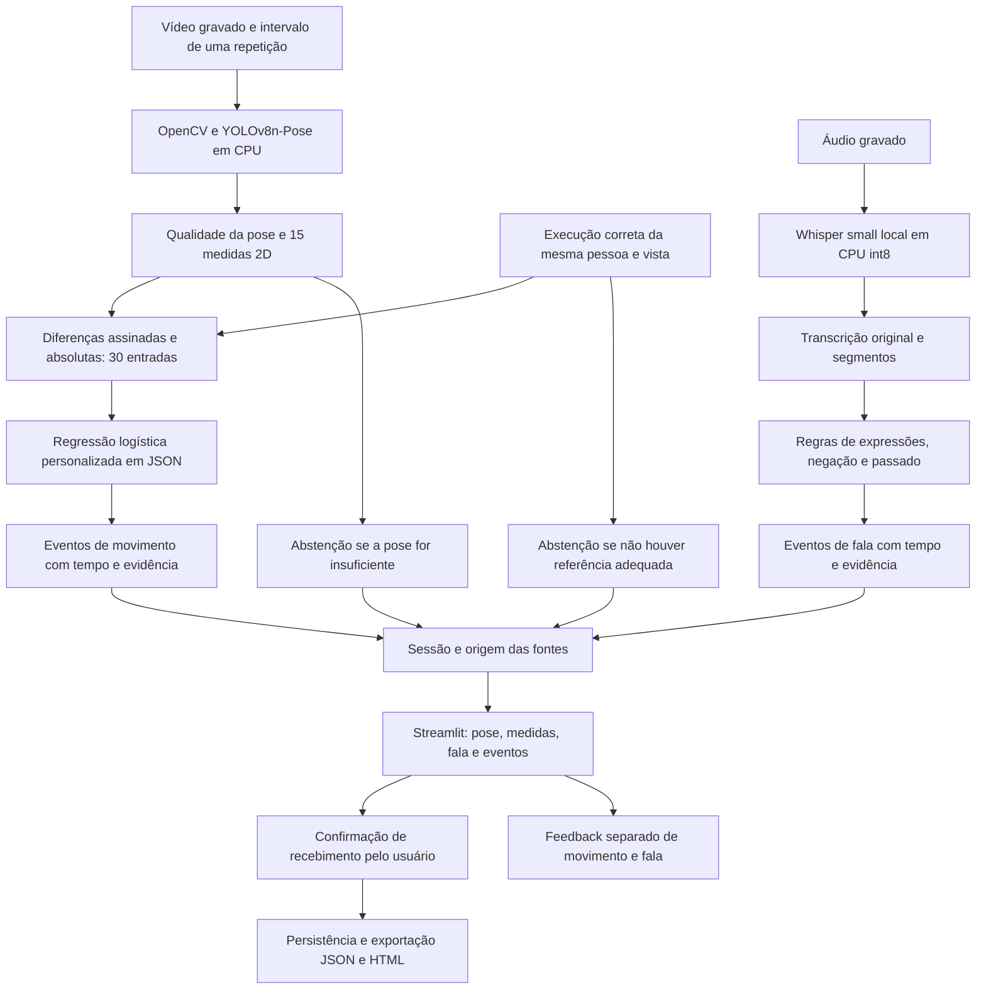

# Arquitetura implementada

Sem referência correta disponível, o caminho de classificação se encerra em abstenção. Na consulta que se sobrepõe à própria referência, a saída é **calibração**, sem escore.

Os exemplos usam vídeo do REHAB24-6 e áudios próprios independentes. A aplicação mantém essa origem explícita. Somente ao selecionar a fala contida no próprio vídeo usa um relógio comum e combina eventos de modalidades diferentes próximos em até cinco segundos.

Dados e modelos são preparados com internet; o processamento usa arquivos e pesos locais. O fluxo de alerta termina no painel, na confirmação e nos relatórios. A implementação não contém envio de notificações a destinatários externos.

O diagrama também é incluído no PDF pelo [gerador do relatório](../../scripts/gerar_relatorio_tecnico.py). Os métodos e resultados estão no [relatório técnico](relatorio-tecnico.md).
