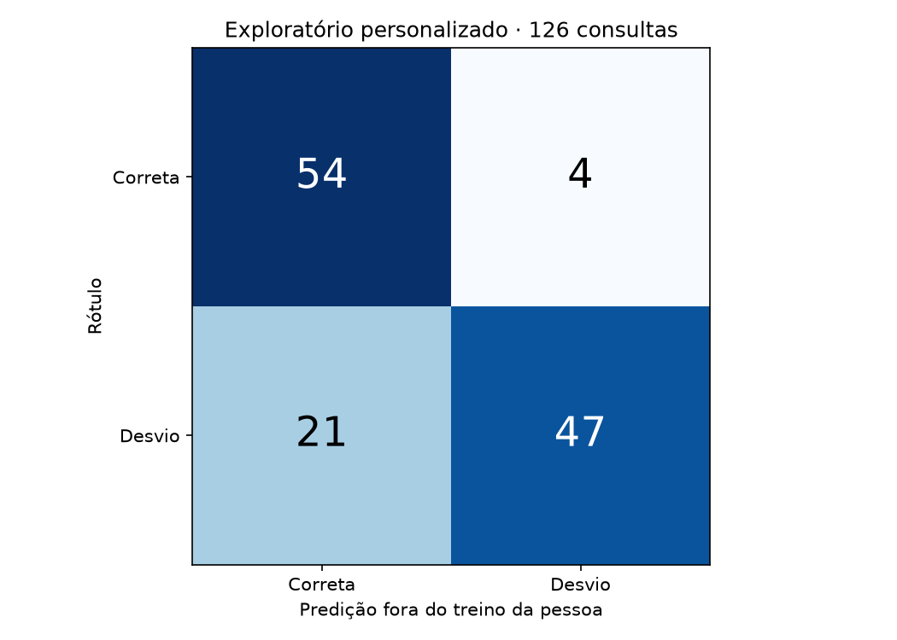
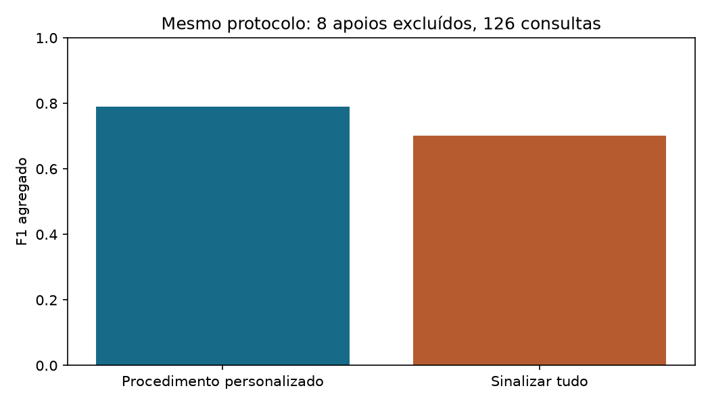

# Relatório técnico — revisão de 16/11/2026

## 1. Problema e escopo

O Observa é um protótipo local de revisão multimodal de um exercício de reabilitação: vídeo e áudio. O texto é saída da transcrição. O recorte segue a orientação do grupo de executar localmente e contemplar duas frentes. O PDF do desafio original está em context/.

A aplicação estima articulações, calcula medidas por repetição e compara o movimento com uma referência correta da mesma pessoa e vista. Em paralelo, transcreve fala em português, identifica expressões de atenção e alguns contextos de negação e passado. Reúne evidências, registra confirmação de recebimento e exporta relatórios JSON/HTML.

O objetivo é demonstrar processamento, avaliação e integração rastreável. A solução é experimental e opera sobre arquivos gravados. Não demonstra diagnóstico, benefício clínico ou garantia de tempo real. A segmentação das repetições é fornecida pelo dataset ou informada manualmente.

O PDF original menciona cloud e outras frentes. O escopo atualizado informado pelo grupo permite execução local e duas modalidades. O áudio é analisado pelo conteúdo transcrito, sem classificador de alterações acústicas, fadiga ou disartria. Não foram implementados Azure, sinais vitais, prescrições ou envio de notificações a destinatários externos. A detecção de desvios de movimento é supervisionada pelos rótulos da base, e não uma detecção não supervisionada de anomalias.

## 2. Dados e histórico do experimento

Vídeo: REHAB24-6, exercício 1, câmera 17, vista frontal, oito participantes e 134 repetições. Os vídeos foram obtidos por intervalos HTTP do arquivo oficial e verificados por tamanho e CRC. Fonte: https://zenodo.org/records/13305826. Os termos indicados são de uso acadêmico ou pesquisa não comercial, com citação dos autores.

Em 14/11, o experimento original separou pessoas: treino 1–4 (51 repetições), validação 5 e 7 (41), teste 8 e 9 (42). A regressão logística original obteve F1 0.389 no teste, abaixo da referência de sinalizar tudo. Seus artefatos e resultados foram preservados sem alterações. A revisão manual identificou, entre outros, falso alerta na repetição 1 de PM_001 e desvio perdido na repetição 6.

Em 15/11, todos esses exemplos passaram a ser dados de desenvolvimento. Os novos experimentos são retrospectivos; não possuem um novo teste inédito. Essa distinção impede apresentar a diferença entre F1 de protocolos diferentes como ganho confirmado de generalização.

Áudio: oito gravações próprias em português, A01–A04 para calibração e A05–A08 na avaliação reservada de 14/11. Referências são os roteiros em data/scenarios/roteiros-audio.csv. Em 15/11 o usuário confirmou não ter percebido divergências adicionais na calibração, além do erro conhecido em A04. Em 16/11, Bruno confirmou por escuta que A05–A08 coincidem com os roteiros. A revisão foi feita pelo próprio autor das gravações; não é anotação independente e cega. O registro posterior está em reports/audio-revisao-manual-16-11.json; o resultado original de 14/11 foi preservado.

## 3. Arquitetura e modelos

Execução em Python 3.11 com OpenCV, YOLOv8n-Pose, NumPy, scikit-learn, faster-whisper, jiwer e Streamlit. Versões em requirements-lock.txt. Inferência em CPU, com pesos locais. Internet é necessária para obter dependências, dados e modelos; não há API de cloud no processamento.

Vídeo: um quadro a cada seis, aproximadamente 5 FPS de uma origem de 30 FPS, resolução de inferência 640. Seleciona-se inicialmente a maior pessoa e depois a mais próxima do centro anterior. Articulações necessárias devem ter confiança mínima 0,35. Exige-se cobertura de 65% e pelo menos cinco amostras válidas no intervalo. A ausência de pose ou referência produz abstenção.

As seis medidas originais foram ampliadas para quinze: amplitude e percentis de abdução, cotovelo, inclinação do tronco, assimetria de ombros e duração, com medidas adicionais na fase elevada, velocidade e posição temporal do pico. A fase elevada é definida por abdução maior ou igual a 60% do máximo observado na repetição. As medidas são projeções 2D, sensíveis à perspectiva.

No protocolo personalizado, o vetor de entrada reúne diferenças assinadas e absolutas entre as quinze medidas da execução e da referência correta, totalizando trinta características. O artefato final escolhido é regressão logística padronizada, C=0,3, classes balanceadas e limiar 0,5. Exportação em JSON sem pickle, com inferência verificada contra scikit-learn. O escore não é probabilidade clínica.

Áudio: Whisper small multilíngue via faster-whisper, CPU int8, idioma pt, VAD e beam_size=5. Regras explícitas para dor, falta de ar, negação próxima e passado. A transcrição original é preservada; a hipótese auxiliar sentidor -> senti dor é acompanhada de aviso, sem alterar WER.

## 4. Protocolo de avaliação de 15/11

Primeiro foram comparadas regras lineares e florestas genéricas com validação aninhada por participante. Como essa tentativa não superou a referência simples em F1, foi registrado um segundo protocolo, personalizado, com uma execução correta de apoio por pessoa.

A referência é a primeira repetição anotada como correta de cada participante. É uma entrada explícita de calibração, não uma previsão e não um rótulo oculto da consulta. As oito referências são excluídas das métricas, restando 126 consultas. O uso exige que uma execução correta da mesma pessoa e vista esteja disponível. Sem essa condição, o resultado não se aplica.

Laço externo: deixar uma pessoa inteira de fora por vez. Laço interno: comparar regressão logística e floresta apenas entre as pessoas restantes, selecionando pela média de F1 por participante. Padronização e ajuste de pesos ocorrem dentro de cada treino. O participante externo fornece somente sua referência correta de apoio, excluída da avaliação; seus rótulos de consulta não entram no ajuste.

Depois da avaliação, o modelo de demonstração é treinado com todas as consultas de desenvolvimento e referências. Os resultados mostrados no painel são testes funcionais sobre exemplos conhecidos; não são as predições fora de treino usadas nas métricas. O experimento é retrospectivo, planejado após observar a limitação de v1, e requer confirmação futura com novos participantes.

Nos exemplos PM_001, a repetição 1 é apoio. O painel a marca como calibração e não a classifica; intervalos próprios que se sobreponham à referência também são marcados assim. A repetição 2 permite inspecionar uma execução correta distinta. A repetição 6 é sinalizada pelo modelo final do painel, mas foi falso negativo na predição externa sem ajuste nas consultas dessa pessoa. É um exemplo concreto da diferença entre demonstração e avaliação.

## 5. Resultados medidos

Resultado original de 14/11: F1 0.389 em 42 repetições de duas pessoas não usadas no treino original. Mantido em reports/video-test-metrics.json.

Experimento genérico retrospectivo de 15/11: F1 0.641 em 134 repetições. A referência de sinalizar tudo obteve F1 0.673. Essa tentativa não foi adotada como melhoria principal.

Experimento personalizado retrospectivo: 126 consultas de oito pessoas, mais oito referências de calibração não pontuadas. F1 agregado 0.790; precisão 0.922; recall 0.691; acurácia 0.802. F1 médio entre participantes 0.691. Matriz [TN, FP; FN, TP]: [[54, 4], [21, 47]]. A referência de sinalizar tudo obteve F1 0.701 neste mesmo conjunto de consultas.

Ainda houve 21 desvios perdidos e quatro falsos alertas. O participante 3 teve F1 zero; a variação entre pessoas deve ser mostrada. Portanto, o resultado é uma evidência exploratória condicional, não validação clínica ou garantia para uma pessoa nova. O protocolo, a quantidade de consultas e a calibração adicional diferem do primeiro teste de 14/11.

Áudio reservado de 14/11: quatro arquivos, 30 palavras de referência, WER 0.00% em relação aos roteiros e concordância das classes textuais 100% (4/4). A normalização remove pontuação, ignora maiúsculas e compacta espaços, preservando acentos. Amostra pequena e de um contexto de gravação. O glossário geral testado em 15/11 não melhorou A04: WER de calibração 7.14%, com a união sentidor ainda presente. O glossário não foi adotado.

Verificações de código incluem 28 testes de geometria, contexto, qualidade, metadados de idioma, preservação dos artefatos v1, exclusão das referências das métricas, ausência do rótulo da consulta na decisão, reprodução das referências e igualdade entre JSON e scikit-learn. Os 28 passaram novamente em 16/11. O teste do painel cobre análise, confirmação persistida e feedback separado. Em 15/11, um Chrome isolado verificou metadados ativos, processamento, confirmação e downloads reais de JSON/HTML sem exceções JavaScript. Bruno confirmou também o recebimento e a abertura dos dois arquivos na aba pessoal após o tratamento do conflito de tradução automática. A reprodução funcional de 16/11 está em reports/entrega/verificacao-16-11.json.

## 6. Fluxo de alerta, revisão e limitações

As duas modalidades produzem eventos com tempo relativo à fonte e evidência. Fontes independentes são identificadas como cenário composto e não geram uma alegação de sincronização clínica. Somente quando o áudio vem do próprio vídeo usa-se o mesmo relógio para combinar eventos próximos em uma janela de cinco segundos. Proximidade não demonstra causalidade.

O usuário confirma recebimento do alerta e pode baixar JSON e HTML. A confirmação não significa aprovação do classificador ou conduta médica. Os relatórios registram ID, parâmetros, referência, transcrição original, medidas, eventos e horário de confirmação. Feedback de movimento e fala é separado, preservando registros anteriores.

Limitações: oito participantes no vídeo, gravações controladas, projeção 2D, seleção heurística da pessoa, intervalos anotados ou manuais, referência correta assumida, falso negativo ainda frequente e texto com regras restritas. O usuário precisa fornecer uma referência adequada em arquivos próprios; o programa não verifica identidade ou qualidade clínica dessa referência.

Ensaios iniciais de pose levaram cerca de 5,5–5,9 s por trecho de 60 quadros, incluindo inicialização; não demonstram tempo real a 30 FPS. Máquina de desenvolvimento: Windows, oito processadores lógicos e aproximadamente 15,8 GiB de memória. Cache reutiliza medidas já extraídas e deve ser distinguido de tempo de inferência novo.

Próxima investigação: novos participantes reservados, qualidade de pose, detecção de compensações e segmentação automática. Novas decisões orientadas pelos erros já observados tornam esses exemplos dados de desenvolvimento, não um teste independente renovado.

## 7. Reprodução e preparação da entrega

Repositório público: https://github.com/brunosouza2/observa-monitory. Abrir o painel neste computador: powershell -NoProfile -ExecutionPolicy Bypass -File .\iniciar-painel.ps1. URL local: http://127.0.0.1:8501. Instruções de teste: docs/testes/teste-15-11.md. Checklist: TAREFAS.md.

Reproduzir experimentos: python scripts/experimento_movimento_v2.py e depois python scripts/experimento_referencia.py, com caches de pose já obtidos. A obtenção e a extração originais estão em docs/operacao/reproducao.md. Resultados novos em reports/v2; artefatos em configs/movement-reference-v2.json e configs/movement-references-v2.json. Gerar este documento: python scripts/gerar_relatorio_tecnico.py.

O relatório original foi arquivado em docs/historico/relatorio-tecnico-14-11.md e .pdf. Nenhum resultado original é substituído pelas novas métricas. Não comparar 0,39 e 0,79 como se o teste, a calibração e as pessoas de treino fossem idênticos.

Em outro computador, instalar Python 3.11 e dependências fixadas, baixar os oito vídeos selecionados, YOLOv8n-Pose e Whisper small conforme README. Gravações pessoais precisam ser fornecidas separadamente ou substituídas por uploads próprios. O clone contém código, configurações, relatório e resultados, mas não dados brutos, pesos ou ambiente Python. A reprodução de 16/11 usa a instalação local já preparada e caches existentes; não comprova instalação limpa em outra máquina.

Evidências selecionadas em reports/entrega: calibração, consulta correta distinta, possível desvio com fala afirmativa e confirmação, e erro conhecido de transcrição com aviso. Há JSON/HTML e manifesto de ambiente e hashes. São verificações funcionais automatizadas: a confirmação nelas foi acionada pelo script, sem representar feedback humano. Os arquivos não incluem mídia bruta. Regenerar com python scripts/preparar_demonstracao.py.

Roteiro e preparação dos colegas: docs/apresentacao/roteiro-video.md e docs/apresentacao/guia-do-grupo.md. A demonstração será neste computador. A passagem interna e o ensaio pelo grupo exigem confirmação humana. Publicar vídeo de até 15 minutos no YouTube ou Vimeo e conferir acesso. Link da apresentação: pendente de gravação e publicação em 17/11/2026. Prazo de submissão: 17/11/2026, às 23h59, horário de Brasília.

Fontes: REHAB24-6 — https://zenodo.org/records/13305826; YOLOv8 — https://docs.ultralytics.com/models/yolov8/; faster-whisper — https://github.com/SYSTRAN/faster-whisper; scikit-learn LeaveOneGroupOut — https://scikit-learn.org/stable/modules/generated/sklearn.model_selection.LeaveOneGroupOut.html. As fontes possuem seus próprios termos e licenças.

## Figuras

- [Arquitetura implementada](arquitetura.md) (diagrama também incluído no PDF).

